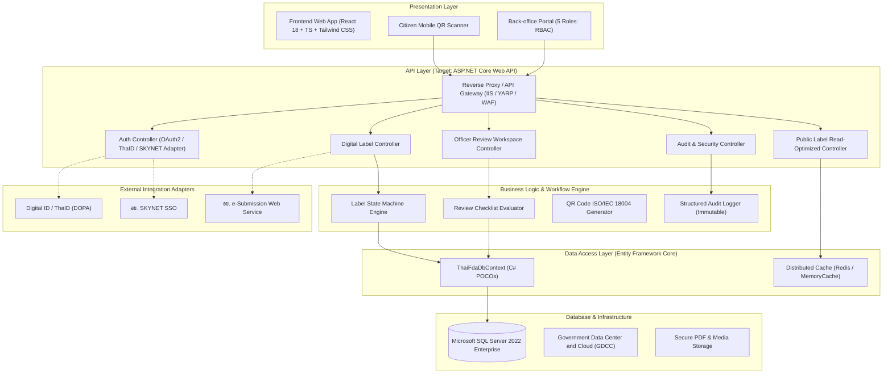
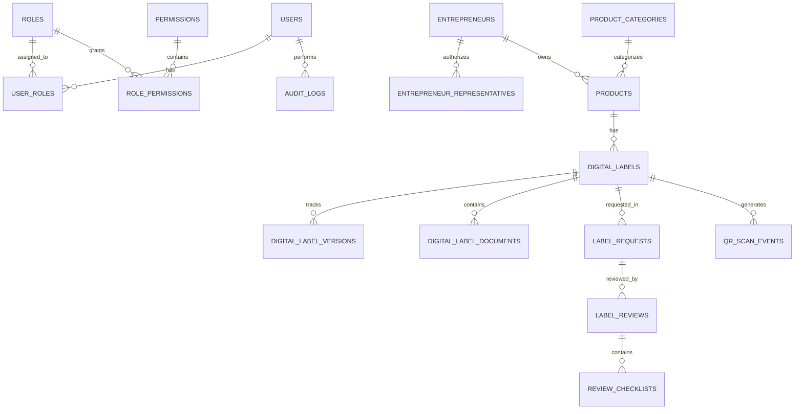
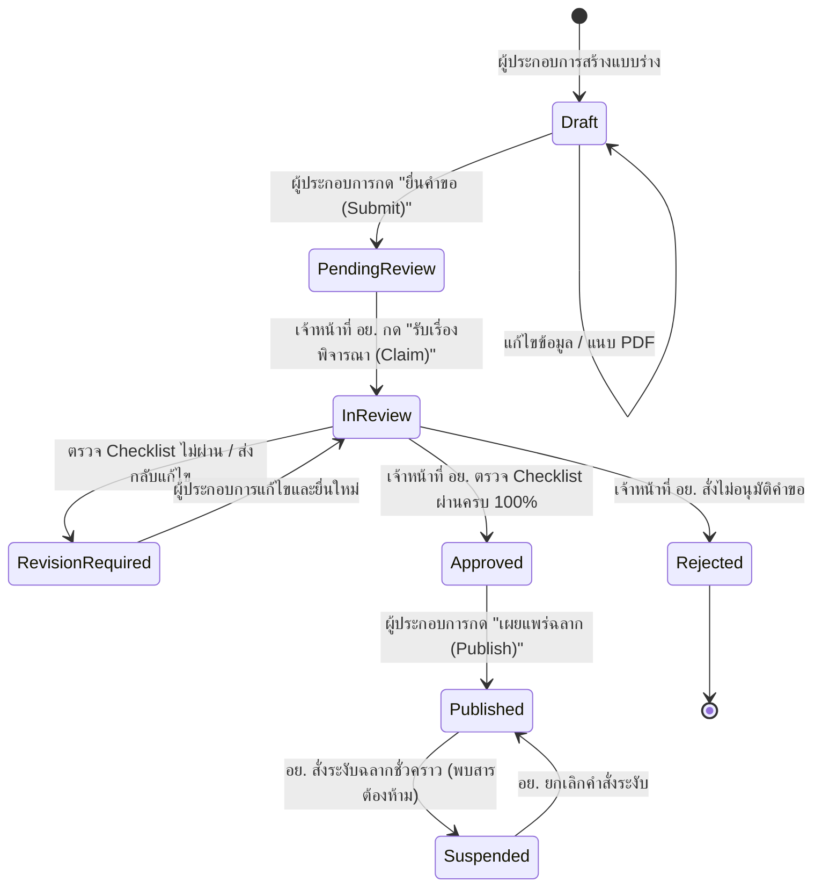

# สถาปัตยกรรมระบบสารสนเทศฉลากดิจิทัล อย.
## (Thai FDA Digital Labeling Platform Architecture & Specification)

---

## 1. ภาพรวมสถาปัตยกรรมระบบ (Multi-Tier Enterprise Architecture)

ระบบฉลากดิจิทัลของสำนักงานคณะกรรมการอาหารและยา (อย.) ได้รับการออกแบบตามมาตรฐานสถาปัตยกรรมรัฐบาลดิจิทัล (Digital Government Enterprise Architecture) รองรับการประมวลผลแบบกระจายตัว ความมั่นคงปลอดภัยระดับสูง และการขยายตัวเพื่อรองรับการสแกน QR Code จากผู้บริโภคพร้อมกันจำนวนมาก



---

## 2. ผังโครงสร้างฐานข้อมูล (Entity-Relationship Diagram)



---

## 3. ผังขั้นตอนการเปลี่ยนสถานะฉลาก (Label State Machine Workflow)



---

## 4. แนวทางการนำขึ้นระบบ Production (Deployment Guide)

### 4.1 การ Deploy บน Vercel (Frontend Client)
1. **Repository Setup**: เชื่อมต่อ Git Repository เข้ากับ Vercel Dashboard
2. **Framework Preset**: เลือก `Vite`
3. **Build Command**: `npm run build`
4. **Output Directory**: `dist`
5. **SPA Routing**: โปรเจกต์มีไฟล์ `vercel.json` กำหนด SPA URL Rewrites ไว้อย่างสมบูรณ์ ทำให้ URL เช่น `/verify/:newcode` สามารถ Refresh ได้โดยไม่ติด 404

### 4.2 การนำขึ้น Windows Server 2022 + IIS
สำหรับสภาพแวดล้อมเครือข่ายภายในภาครัฐ (Intranet) หรือเครือข่าย GDCC:
1. ติดตั้ง **IIS** พร้อมโมดูล **URL Rewrite Module 2.1**
2. ติดตั้ง **ASP.NET Core Hosting Bundle (v8.0 หรือ v9.0)**
3. นำไฟล์จากโฟลเดอร์ `dist/` วางใน `C:\inetpub\wwwroot\fda-digital-labeling`
4. สร้างไฟล์ `web.config` สำหรับ IIS URL Rewrite:
```xml
<?xml version="1.0" encoding="UTF-8"?>
<configuration>
  <system.webServer>
    <rewrite>
      <rules>
        <rule name="SPA Routes" stopProcessing="true">
          <match url=".*" />
          <conditions logicalGrouping="MatchAll">
            <add input="{REQUEST_FILENAME}" matchType="IsFile" negate="true" />
            <add input="{REQUEST_FILENAME}" matchType="IsDirectory" negate="true" />
            <add input="{REQUEST_URI}" pattern="^/(api)" negate="true" />
          </conditions>
          <action type="Rewrite" url="/" />
        </rule>
      </rules>
    </rewrite>
    <httpProtocol>
      <customHeaders>
        <add name="X-Content-Type-Options" value="nosniff" />
        <add name="X-Frame-Options" value="SAMEORIGIN" />
        <add name="X-XSS-Protection" value="1; mode=block" />
      </customHeaders>
    </httpProtocol>
  </system.webServer>
</configuration>
```

### 4.3 การนำขึ้น Government Data Center and Cloud (GDCC)
- **Containerization**: มีแนวทางสร้าง Docker Container โดยใช้ Base Image `mcr.microsoft.com/dotnet/aspnet` สำหรับ API และ `nginx:alpine` สำหรับ Static Frontend
- **Private Subnet**: วาง SQL Server 2022 ไว้ใน Private Subnet ที่ไม่มี Public IP
- **Web Application Firewall (WAF)**: กำหนดกฎเกณฑ์ป้องกัน OWASP Top 10, SQL Injection และ Rate Limiting สำหรับ Public Scan API

---

## 5. นโยบายความมั่นคงปลอดภัยและการปฏิบัติตาม PDPA

1. **Authentication**: ออกแบบ Adapter สำหรับ Digital ID / ThaID (DOPA) และ SKYNET SSO ในโหมด Demo ได้แสดงสถานะ `Integration Placeholder` อย่างโปร่งใส ไม่มีการหลอกว่าเชื่อมต่อจริง
2. **Role-Based Access Control (RBAC)**: กำหนด 5 บทบาทแยกขาดจากกัน (Public, Entrepreneur, Officer, Admin, Auditor) และตรวจสอบสิทธิ์ทั้งในฝั่ง Frontend และ API Layer
3. **Data Minimization (PDPA)**: การสแกนฉลากสาธารณะจะไม่เก็บพิกัด GPS ละเอียดโดยอัตโนมัติ จะเก็บเพียงระดับกลุ่มจังหวัดและสถิติอุปกรณ์เพื่อความปลอดภัยของผู้บริโภค
4. **Immutable Audit Trail**: บันทึก Audit Log ทุกเหตุการณ์สำคัญ (Login, Draft, Submit, Approve, Suspend) ไม่เปิดให้ผู้ใช้หรือผู้ตรวจลบหรือแก้ไขย้อนหลัง
